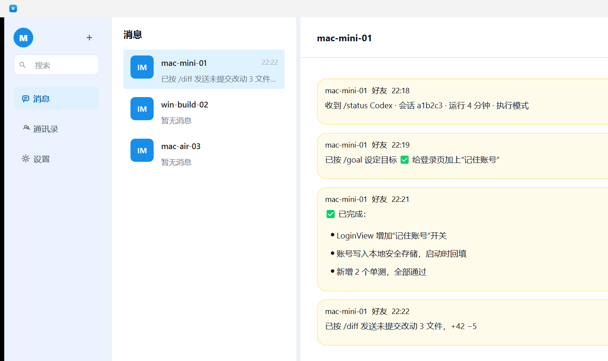

# Multi-AI Code

> 本地优先的 AI CLI 工作台，支持从 IM 远程操控本机 AICLI。桌面端围绕本地仓库驱动 `codex` / `claude` 开发；离开电脑时，用手机或另一端 IM 直接给这台机器的 AICLI 发任务、切模型、看 diff、收结果。

**核心是 IM + AICLI**：它不内置大模型，而是驱动 AI CLI 干活；每台机器登录一个 IM 身份，你把它当聊天联系人，发消息即可驱动它的当前 AICLI，结果清成 Markdown 回传。多台机器就是多个联系人，各自独立驱动。

> **`codex` 只用随应用打包的内置版本**（已做大量定制，不再兼容宿主机上自行安装的版本）；缺少内置二进制会直接报错、绝不回退宿主机版本。`claude` 仍使用你本机安装并登录的版本。



## IM 控制命令

MaiChat iOS、Android 或桌面客户端，以及通过 `imcli` 的 AICLI，均可给目标机器发消息。MaiChat 客户端、MaiAgent 与配套服务的源码位于独立的 [MaiChat 仓库](https://github.com/wanhongqing123/MaiChat)；双方沿用远程 IM 互操作协议。除直接发任务文本外：

| 命令 | 作用 |
| --- | --- |
| `/status` | 查看 AICLI 状态 |
| `/plan` · `/build` | 切换计划 / 执行模式 |
| `/models` · `/model <序号\|ID\|档位>` | 查看 / 切换模型或推理档位 |
| `/goal [目标\|clear\|pause\|resume]` | 管理 Goal |
| `/btw <任务>` | 起子 Agent 处理并回传 |
| `/diff [--stat] [路径]` | 发送未提交改动 |
| `/interrupt` · `/compact` · `/clear` | 中断 / 压缩 / 清空会话 |

> `codex` 支持全部命令；`claude` 仅任务注入 + `/status` + `/diff`。仅白名单联系人可下发，桌面端不执行远程 shell。

## 快速开始

```bash
npm install
npm run dev      # 开发启动
npm run build    # 构建
```

`codex` 用随应用打包的内置定制版——源码开发需先构建：`git submodule update --init --recursive && npm run build:aicli`（生成 `bin/aicli`），否则启动会报「未找到内置可执行文件」。`claude` 需本机安装并登录。数据按 IM 账号隔离存本机。

Multi-AI Code 安装包见本仓库的 [Releases](https://github.com/wanhongqing123/multi-ai-code/releases)（Electron tag `electron-<日期>`）。MaiChat 的源码和发布信息见 [MaiChat 仓库](https://github.com/wanhongqing123/MaiChat)。
